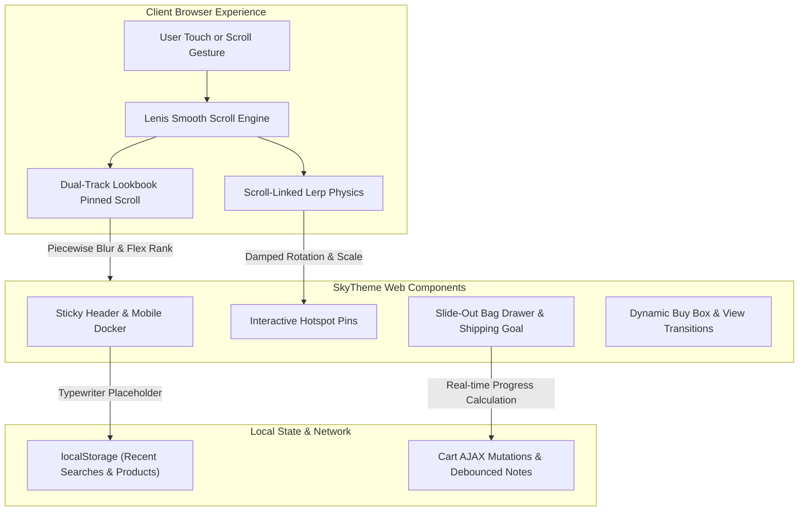

<div align="center">


# 🛍️ SkyTheme Luxury Storefront Engine

### Haute Couture E-Commerce Architecture & Multi-Agent Storefront Generator
**Lenis Momentum Scrolling • Dual-Track 3D Lookbook • Accessible Bag Drawer • 40+ Merchandising Features**

[](package.json)
[](LICENSE)
[](https://bun.sh)
[](evals/evals.json)
[](https://skills.sh)
[](https://claude.ai)
[](https://cursor.com)
[](https://github.com/imMamdouhaboammar/agent-kernel)

<p align="center">
  <a href="#-overview">Overview</a> •
  <a href="#-invariants">Invariants</a> •
  <a href="#-features-matrix">Features Matrix</a> •
  <a href="#-architecture">Architecture</a> •
  <a href="#-quickstart">Quickstart</a> •
  <a href="#-multi-agent-distribution">Distribution</a> •
  <a href="#-evaluations">Evaluations</a> •
  <a href="#-cli-reference">CLI Reference</a>
</p>

</div>

---

## 📖 Overview

**SkyTheme Storefront** is a high-presence luxury fashion e-commerce storefront engine reverse-engineered from high-end retail production code. It bridges editorial design, fluid momentum physics, and conversion optimization with zero vendor lock-in.

Whether generating **Vanilla HTML5 / Web Components**, **Shopify Liquid Themes**, or **React / Next.js with Tailwind**, SkyTheme provides verified design tokens, physics curves, and accessible component architectures directly out of the box.

---

## 🛡️ Non-Negotiable Invariants

All storefronts generated and evaluated by this skill strictly enforce the four codified Agent Kernel rules:

1. **Touch-Momentum & Smooth Scroll Gating:** Programmatic scroll hijacking is strictly gated behind desktop viewports (`!window.matchMedia('(pointer: coarse)').matches && window.innerWidth >= 768`). Mobile devices retain native 120Hz ProMotion/Android momentum.
2. **Accessible Drawer & Modal Confinement:** Every slide-out drawer (`<bag-drawer>`, `<predictive-search>`, `<quick-view-drawer>`) implements `role="dialog"`, `aria-modal="true"`, background scroll locking, Tab focus trapping, and `Escape` key dismissal.
3. **RAF Loop Lifecycle & Epsilon Cancellation:** In scroll-linked Lerp damping animations, an epsilon threshold (`|target - current| < 1e-4`) cancels `requestAnimationFrame` upon settling to prevent GPU battery drain.
4. **GitHub Markdown Mermaid Safety:** All Mermaid diagrams wrap all node labels `["..."]` and edge annotations `-->|"...|"|` in double quotes to guarantee 100% rendering compatibility across GitHub.

---

## 🏛️ Architecture



---

## ⚡ Features Matrix (40+ Included Capabilities)

| Domain | Feature | Description | Reference Implementation |
| :--- | :--- | :--- | :--- |
| **Cart & Checkout** | **Slide-out cart** | Accessible drawer with focus trap & scroll locking | [`references/cart-and-checkout-architecture.md`](references/cart-and-checkout-architecture.md) |
| | **Free shipping goal** | Animated gradient progress bar updating in real-time | [`references/cart-and-checkout-architecture.md`](references/cart-and-checkout-architecture.md) |
| | **Cart notes** | Auto-saving debounced customer note field | [`references/cart-and-checkout-architecture.md`](references/cart-and-checkout-architecture.md) |
| | **In-store pickup** | Modal displaying local store availability | [`references/cart-and-checkout-architecture.md`](references/cart-and-checkout-architecture.md) |
| | **Discount engine** | Instant coupon application inside slide-out drawer | [`references/cart-and-checkout-architecture.md`](references/cart-and-checkout-architecture.md) |
| | **Shipping estimator** | AJAX regional shipping rate calculator | [`references/cart-and-checkout-architecture.md`](references/cart-and-checkout-architecture.md) |
| **Merchandising** | **Lookbook 3D** | Dual-track pinned scroll with rank-decay and Gaussian blur | [`references/animation-engine-and-motion.md`](references/animation-engine-and-motion.md) |
| | **Shop The Look** | Interactive hotspot pins bidirectionally synced with Swiper | [`references/merchandising-and-media.md`](references/merchandising-and-media.md) |
| | **PhotoSwipe Zoom** | v5 lightbox with full-resolution pinch & zoom | [`references/merchandising-and-media.md`](references/merchandising-and-media.md) |
| | **Hover video autoplay** | Streaming lazy video with smooth poster cross-fade | [`references/merchandising-and-media.md`](references/merchandising-and-media.md) |
| | **Color swatches** | Circular color fills with active focus rings | [`references/design-system-and-tokens.md`](references/design-system-and-tokens.md) |
| | **Before/After slider** | Touch-friendly split-screen fabric comparison | [`references/merchandising-and-media.md`](references/merchandising-and-media.md) |
| **Discovery** | **Mobile Docker** | Bottom ergonomics dock with safe-area offset | [`references/product-discovery-and-navigation.md`](references/product-discovery-and-navigation.md) |
| | **Sticky Header** | Scroll thresholds, buffer zones, and auto-hide/reveal | [`references/product-discovery-and-navigation.md`](references/product-discovery-and-navigation.md) |
| | **Typewriter search** | Predictive search with typewriter running placeholder | [`references/product-discovery-and-navigation.md`](references/product-discovery-and-navigation.md) |
| | **Mega Menu** | Tabbed category navigation with embedded promos | [`references/product-discovery-and-navigation.md`](references/product-discovery-and-navigation.md) |
| **Conversion** | **Countdown timer** | Evergreen interval (2h, 6h, 24h) and fixed date modes | [`references/marketing-and-conversion.md`](references/marketing-and-conversion.md) |
| | **Stock counter** | Low-stock urgency warning (< 5 units) | [`references/marketing-and-conversion.md`](references/marketing-and-conversion.md) |
| | **Recently viewed** | Zero-backend history tracking via `localStorage` | [`references/marketing-and-conversion.md`](references/marketing-and-conversion.md) |
| | **Quick view** | Full PDP drawer overlay on collection grids | [`references/marketing-and-conversion.md`](references/marketing-and-conversion.md) |
| | **Trust badges** | Sustainable fibers, 30-day returns, secure checkout | [`references/marketing-and-conversion.md`](references/marketing-and-conversion.md) |

---

## 🚀 Quickstart

### 1. Instant Scaffolding (CLI)
```bash
# Generate a complete standalone SkyTheme storefront into ./dist:
bun scripts/generate-storefront.ts --name "Maison Noir" --out ./dist --scheme scheme-2
```

### 2. Validate Storefront Invariants
```bash
# Run structural, accessibility, and motion checks on any HTML file:
bun scripts/validate-storefront.ts ./dist/index.html
```

### 3. Run Behavioral Evals
```bash
# Run benchmark test suite:
bun scripts/run-evals.ts
```

---

## 🌐 Multi-Agent Distribution

SkyTheme Storefront is distributed as a universal agent skill across all major AI harnesses:

```bash
# One-liner automated multi-agent installer:
curl -fsSL https://raw.githubusercontent.com/imMamdouhaboammar/skytheme-storefront/main/install.sh | bash
```

### Manual Channel Integration:

| AI Harness | Integration Path | Status |
| :--- | :--- | :--- |
| **Claude Code** | `~/.claude/skills/skytheme-storefront` | Certified |
| **Antigravity / Gemini CLI** | `~/.gemini/config/skills/skytheme-storefront` | Certified |
| **Cursor** | `.cursor/skills/skytheme-storefront` | Certified |
| **Codex / OpenCode** | `~/.codex/skills/skytheme-storefront` | Certified |
| **Agent Kernel** | `~/.agents/skills/skytheme-storefront` | Master Synced |
| **Skills.sh (Vercel)** | `npx skills add imMamdouhaboammar/skytheme-storefront` | Registered |

---

## 🧪 Behavioral Evaluations & Verification

SkyTheme includes a comprehensive benchmark suite evaluated via deterministic runtime execution:

```text
==========================================================
📊 EVALUATION SUMMARY: 10 Passed, 0 Failed out of 10 benchmarks
   Evidence State: OBSERVED (Deterministic Bun Execution)
   Integrity Gate: ALL PASS (GREEN)
==========================================================
```

- **Test Bank**: [`evals/evals.json`](evals/evals.json)
- **Runner**: `bun scripts/run-evals.ts`

---

## 🛠️ CLI Reference

| Command / Flag | Type | Default | Description |
| :--- | :--- | :--- | :--- |
| `generate` | Command | — | Scaffold a complete SkyTheme luxury storefront |
| `--name` | Option | `"AURA LUXE"` | Store brand name rendered across header and titles |
| `--out` | Option | `"./storefront-dist"` | Destination directory for scaffolded assets |
| `--scheme` | Option | `"scheme-1"` | Color scheme ID (`scheme-1` through `scheme-5`) |
| `validate` | Command | — | Validate HTML against design, motion, and accessibility invariants |
| `eval` | Command | — | Execute the 10-benchmark behavioral evaluation suite |

---

## 📄 License

MIT © [Mamdouh Aboammar](https://github.com/imMamdouhaboammar).
