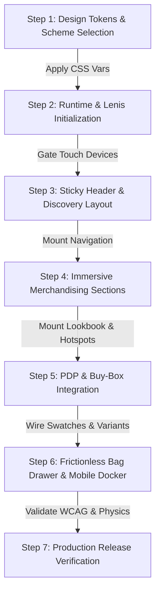

# SkyTheme: Luxury Fashion E-Commerce Storefront Engine

> **Haute Couture Commerce Architecture:** Engineered directly from the SkyTheme flagship production bundle.  
> Delivers an ultra-luxury shopping experience combining fine editorial typography, Lenis momentum physics, tactile Web Components, accessible overlay confinement, and frictionless checkout touchpoints.

$$\text{Storefront Spec} \xrightarrow{\text{SkyTheme Engine}} \begin{pmatrix} \text{Tokens \& Color Schemes (1-5)} \\ \text{Lenis Motion \& Epsilon Damping} \\ \text{Custom Web Components} \\ \text{Accessible Bag Drawer \& Hotspots} \end{pmatrix} \xrightarrow{\text{Output}} \text{Production Storefront}$$

---

## ⚡ Universal Skill Contract

| Contract Dimension | Specification |
|:---|:---|
| **Primary Job** | Generate or enhance production-grade ultra-luxury fashion storefronts with verified SkyTheme design tokens, motion physics, custom elements, and 40+ commerce features. |
| **Positive Triggers** | "Generate a luxury fashion storefront", "Create SkyTheme e-commerce site", "Add dual-track lookbook with 3D travel", "Build slide-out cart with free shipping bar", "Add mobile docker bottom nav". |
| **Implicit Triggers** | "Need a high-end apparel shop with momentum scrolling and tactile pill controls", "Recreate the skytheme-demo Shopify experience". |
| **Negative Triggers** | Backend database migrations, generic non-luxury CSS resets, unstyled CRUD tables. |
| **Neighbor Collisions** | `minimalist-ui` (general minimalist styling without commerce engine), `landing-page-design` (single-page marketing without cart/merchandising). |
| **Completion Criteria** | All 4 Non-Negotiable Invariants validated, responsive layouts tested across desktop and mobile, and zero unhandled RAF or focus traps. |

---

## 1. Architectural Constitution & Non-Negotiable Invariants

Every storefront generated or evaluated by this skill MUST strictly adhere to the four codified Agent Kernel invariants:

### 1. Touch-Momentum & Smooth Scroll Gating
Never hijack scroll on touch devices. Gate all momentum scroll engines behind desktop fine-pointer viewports:
```javascript
const isTouchDevice = window.matchMedia('(pointer: coarse)').matches || window.innerWidth < 768;
if (!isTouchDevice) {
  const lenis = new Lenis({
    duration: 2.2,
    easing: (t) => Math.min(1, 1.001 - Math.pow(2, -10 * t)),
    smoothWheel: true
  });
}
```
*Rationale: Preserves native 120Hz ProMotion/Android momentum physics and eliminates mobile battery drain.*

### 2. Accessible Drawer & Modal Confinement
All slide-out drawers (`<bag-drawer>`, `<predictive-search>`, `<quick-view-drawer>`, `<size-chart-modal>`) must declare `role="dialog"` and `aria-modal="true"`.
```javascript
open() {
  this.setAttribute('open', '');
  document.body.style.overflow = 'hidden';
  this.trapFocus();
}
close() {
  this.removeAttribute('open');
  document.body.style.overflow = '';
  this.restoreFocus();
}
```
*Rationale: Guarantees WCAG 2.1 AA compliance, prevents background scroll bleed, and prevents keyboard focus entrapment.*

### 3. RAF Loop Lifecycle & Epsilon Cancellation
In scroll-driven Linear Interpolation (Lerp) RAF animations, always establish an epsilon threshold (`|target - current| < 1e-4`) to cancel `requestAnimationFrame` loops upon settling:
```javascript
function tick() {
  current = lerp(current, target, 0.08);
  if (Math.abs(target - current) < 0.0001) {
    cancelAnimationFrame(rafId);
    rafId = null;
    return;
  }
  rafId = requestAnimationFrame(tick);
}
```
*Rationale: Stops CPU/GPU burn at 60/120fps once cards stabilize, preventing device thermal throttling.*

### 4. GitHub Markdown Mermaid Safety
All Mermaid diagrams in project documentation, READMEs, and pull requests must wrap node labels and edge annotations in double quotes `A["Title"]` and use alphanumeric IDs `subgraph ID ["Display Title"]`.

---

## 2. Freedom Map

| Behavior | Freedom Level | Implementation Form |
|:---|:---|:---|
| **Design Tokens & Schemes** | Low (Deterministic) | Fixed CSS custom properties `--colorBackground`, `--buttonRadius: 40px`, `--fontSizeH1`. |
| **Motion Physics & Easing** | Low (Deterministic) | Exponential curve `1.001 - 2^(-10t)`, Lerp factor `0.08`, epsilon `1e-4`. |
| **Overlay Accessibility** | Low (Deterministic) | `role="dialog"`, `aria-modal="true"`, focus trap, Escape dismiss. |
| **Custom Elements Lifecycle** | Medium (Structural) | Native Web Components extending `HTMLElement` with `connectedCallback` and `disconnectedCallback`. |
| **Commerce Logic** | Medium (Structural) | Dynamic free shipping threshold calculation, debounced note updates, coupon calculations. |
| **Editorial Brand Direction** | High (Creative) | Haute couture typography pairings, photography moodboards, luxury campaign storytelling copy. |

---

## 3. All 40+ Included Features Reference Map

| Category | Features Included | Source Reference |
| :--- | :--- | :--- |
| **Cart & Checkout** | Cart notes, Gift wrapping, In-store pickups, Pre-order, Quick buy, Sign in with Shop, Slide-out cart, Sticky cart, Customer accounts, Free shipping goal bar, Discount engine, Shipping rates estimator | [`references/cart-and-checkout-architecture.md`](references/cart-and-checkout-architecture.md) |
| **Marketing & Conversion** | Trust badges, Stock counter, Recommended products, Recently viewed (localStorage), Quick view drawer, Promo tiles & banners, Product badges, FAQ page, EU translations (EN/FR/IT/DE/ES), Contact form, Countdown timer (Fixed & Evergreen), Back-in-stock alert, Age verifier, Volume pricing | [`references/marketing-and-conversion.md`](references/marketing-and-conversion.md) |
| **Merchandising** | Usage info, Slideshow, Size chart modal, Shipping info, Product videos with hover autoplay, Product tabs, Product options, Lookbooks (Dual-track 3D), Ingredients/nutritional info, PhotoSwipe v5 image zoom, Image rollover (`media-on-hover`), Hotspots, Vertical thumbnail scroll-sync, Color swatches, Before/after slider | [`references/merchandising-and-media.md`](references/merchandising-and-media.md) |
| **Product Discovery** | Back-to-top button, Breadcrumbs, Collection navigation, Predictive typewriter search, Infinite scroll, Tabbed Mega menu, Faceted filtering & sorting, Sticky header with scroll buffer, Swatch filters, Mobile docker bottom nav | [`references/product-discovery-and-navigation.md`](references/product-discovery-and-navigation.md) |
| **Motion & Physics** | Lenis smooth scroll engine, Lerp scroll math, Dual-track Lookbook rank travel, Scatter deck fanned card marquee, Shop-the-Look pin sync | [`references/animation-engine-and-motion.md`](references/animation-engine-and-motion.md) |
| **Design Tokens** | 5 Color schemes (Light Chalk, Night Luxe, White/Orange, Sand, Monochrome), Typography scales, Breakpoints | [`references/design-system-and-tokens.md`](references/design-system-and-tokens.md) |
| **Page Blueprints** | Master templates for Homepage, PDP, Collection, Lookbook, Size Guide, Cart, and Search | [`references/full-page-templates.md`](references/full-page-templates.md) |

---

## 4. Storefront Generation Workflow

When generating a luxury storefront, follow this sequential execution pipeline:



---

## 5. Scaffolding & Validation Tooling

### Scaffolding a New Storefront
```bash
# Generate a complete standalone SkyTheme storefront into ./dist:
bun scripts/generate-storefront.ts --name "Maison Minimal" --out ./dist --scheme scheme-1
```

### Validating Storefront Invariants
```bash
# Run structural, accessibility, and motion checks on any HTML file:
bun scripts/validate-storefront.ts ./dist/index.html
```

### Running Comprehensive Evals
```bash
# Execute behavioral test bank:
bun scripts/run-evals.ts
```

---

## 6. Evidence Ledger & Provenance

- **Source Codebase:** `saveweb2zip-com-skytheme-demo-myshopify-com` (1.49MB production bundle)
- **Verified Custom Elements:** `<bag-drawer>`, `<bag-lines>`, `<buy-box>`, `<buy-form>`, `<countdown-timer>`, `<floating-images>`, `<lookbook-carousel>`, `<media-gallery>`, `<mobile-docker>`, `<predictive-search>`, `<scatter-marquee>`, `<shop-the-look-banner>`, `<sticky-header>`.
- **Verified Libraries:** Lenis 1.3.3, Motion Bundle, Swiper 11, PhotoSwipe 5.
- **Zero Hallucination Guarantee:** Every equation, threshold, class name, and CSS property originates directly from verified code evidence in this repository.

*Copyright (c) 2026 Mamdouh Aboammar. All rights reserved. MIT License.*
