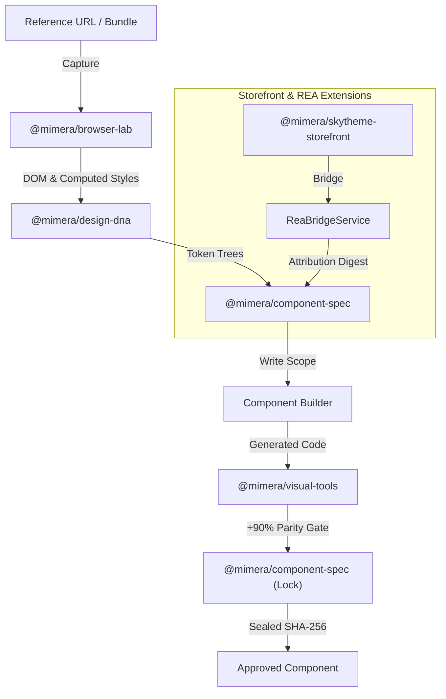

<div align="center">

# 💎 Mimera

### Autonomous Reference-Driven Visual Cloning & Luxury Storefront Engine
**Pixel-Accurate UI Deconstruction • Haute Couture Motion Runtime • /rea Support**

[](LICENSE)
[](https://bun.sh)
[](https://www.typescriptlang.org/)
[](https://skills.sh)
[](https://claude.ai)
[](packages/mcp-server)
[](tests)

<p align="center">
  <a href="#-key-features">Key Features</a> •
  <a href="#-architecture">Architecture</a> •
  <a href="#-cli-commands">CLI Reference</a> •
  <a href="#-the-4-kernel-invariants">Invariants</a> •
  <a href="#-skills-ecosystem">Skills Ecosystem</a> •
  <a href="#-status-audit">Status Audit</a>
</p>

</div>

---

**Mimera** is a local-first, agentic reference-driven interface engineering system. It studies reference applications, extracts design DNA, layout geometries, responsive behavior, and visual tokens, then reconstructs them inside your codebase component-by-component under strict quality rules and user approvals.

---

## ⚡ Architecture



---

## 🚀 Key Features

- **Deterministic Reference Capture**: Captures desktop and mobile responsive evidence, DOM trees, computed styles, network calls, and traces with zero untrusted instructions leakage.
- **Visual Inspection & Simulation Engine (`@mimera/visual-tools`, `@mimera/browser-lab`)**:
  - **Zero-Dependency Native PNG Codec**: Pure TypeScript PNG encoder and decoder using `node:zlib` (`inflateSync`/`deflateSync`) with full scanline unfiltering (Sub, Up, Average, Paeth) and CRC32 verification.
  - **Structural Edge & Color Histogram Engine**: 3x3 Sobel gradient operator for structural edge MSE detection and 48-bin normalized color histogram correlation.
  - **Dynamic Video & Canvas Normalization**: Automatically normalizes volatile asynchronous media (video backgrounds, YouTube iframes, animated canvases) down to 0.3 opacity to eliminate false-positive diff noise.
  - **Playwright Dual-Viewport Vision Auditor**: Automated side-by-side inspection across Desktop (`1440x900`) and Mobile (`390x844`) at 700px vertical increments.
  - **Configurable Visual Parity Gating (+90% Minimum, Target 100%)**: Composite parity scoring (65% structural edge MSE + 25% pixel match + 10% color histogram) enforcing strict build gating.
  - **Box-Model & Spatial Geometry**: Computes element bounding box deltas, center-point distances, padding/margin models, and spatial alignment indices.
  - **Dynamic Region Masking**: Masks volatile layout areas prior to comparison.
  - **Diff Overlay Heatmaps**: Generates visual comparison overlays highlighting pixel shifts and geometry drift.
- **Project-Bound MCP Server (`@mimera/mcp-server`)**: Exposes 17 project-scoped Model Context Protocol (MCP) tools for AI agents:
  - **Browser Tools (6)**: `browser.open_reference`, `browser.take_snapshot`, `browser.take_screenshot`, `browser.inspect_element`, `browser.get_computed_styles`, `browser.close`.
  - **Visual Tools (8)**: `visual.compare`, `visual.compare_element`, `visual.measure_geometry`, `visual.create_overlay`, `visual.score`, `visual.mask_dynamic_region`, `visual.structural_similarity`, `visual.audit_simulation`.
  - **Storefront & REA Tools (3)**: `storefront.generate_luxury`, `storefront.validate_invariants`, `rea.inspect_bundle`.
- **Haute Couture Storefront & Physics Engine (`@mimera/skytheme-storefront`)**:
  - **Lenis Smooth Momentum Scrolling**: Gated behind `!pointer: coarse && innerWidth >= 768`.
  - **3D Lookbook Carousel & Hotspots**: Dual-track momentum rank travel with Lerp math.
  - **Accessible BagDrawer**: Strict `role="dialog"`, `aria-modal="true"`, focus trap, and Escape dismiss.
  - **RAF Epsilon Settling**: Guarantees `requestAnimationFrame` loop cancellation (`|target - current| < 1e-4`).
- **REA (Reverse Engineer Anything) Support**:
  - Deep semantic deconstruction of minified web bundles, obfuscated WebGL/Three.js shaders, and event listeners.
  - Generates verifiable REA Evidence Digests and attribution headers.
- **Cryptographic Regression Locking (`@mimera/component-spec`)**: Seals approved component code, CSS, and evidence contracts into SHA-256 locks to prevent regressions during subsequent edits.
- **Deterministic Hook Security**: Intercepts writes, state transitions, and tool calls with fail-closed security policy enforcing write scopes and command allowlists.
- **Multi-Host Compatibility**: Out-of-the-box adapters for Claude Code, Codex, Cursor, Gemini CLI, and generic terminal runtimes.

---

## 🛡️ The 4 Kernel Invariants

Every template and component generated by Mimera enforces:

1. **Touch-Momentum Gating**: Momentum scroll engines gated behind `!window.matchMedia('(pointer: coarse)').matches && window.innerWidth >= 768`.
2. **Accessible Dialog Confinement**: Modals and drawers declare `role="dialog"` & `aria-modal="true"`, trap focus, lock body scroll, and restore focus on exit.
3. **RAF Settling Epsilon**: All animation loops define `const EPSILON = 1e-4` to cancel frames when target value approximates current.
4. **Mermaid Compatibility**: All Markdown diagram nodes and edge labels are wrapped in double quotes.

---

## 📦 Workspace Architecture

Mimera is structured as a Bun monorepo comprising 23 specialized packages:

| Package | Description |
|---|---|
| `@mimera/contracts` | Core data contracts, Zod schemas, hook definitions, and state interfaces |
| `@mimera/core` | Project lifecycle, session state management, and SQLite persistence |
| `@mimera/state-machine` | Guarded session state transitions and checkpointing |
| `@mimera/hooks` | Deterministic security hooks for write scopes, commands, and evidence trust |
| `@mimera/evidence-store` | Immutable evidence ingestion, SHA-256 digests, and artifact storage |
| `@mimera/browser-lab` | Playwright browser automation, multi-viewport capture, and vision auditor |
| `@mimera/reference-capture` | Responsive evidence pack capture pipeline and policy enforcement |
| `@mimera/reference-policy` | Robots.txt, origin allowlists, private network blocking, and rate limiting |
| `@mimera/visual-tools` | Zero-dependency PNG codec, Sobel edge MSE, color histograms, diffing, and scoring |
| `@mimera/mcp-server` | Project-bound MCP server registering 17 browser, vision, storefront, and REA tools |
| `@mimera/project-inspector` | Workspace analysis, framework detection, and project profiling |
| `@mimera/preflight` | Project preflight profiling and session authorization |
| `@mimera/design-dna` | Token extraction, color harmony analysis, and typography inference |
| `@mimera/design-analysis` | Page decomposition, component boundary detection, and brand mapping |
| `@mimera/component-spec` | Component specification generator, TestDesigner, and RegressionLock service |
| `@mimera/skytheme-storefront` | Haute Couture commerce engine, Lenis motion physics, Web Components, and REA bridge |
| `@mimera/project-tools` | Safe project file operations and atomic patch applicator |
| `@mimera/implementation-workspace` | Isolated component builder workspace and review aggregator |
| `@mimera/agent-runtime` | Portable agent roles, registry, context packets, and task dispatcher |
| `@mimera/context-curator` | Minimal context packet synthesis for agent execution |
| `@mimera/host-adapters` | Adapter generators for Claude, Codex, Cursor, and Gemini CLI |
| `@mimera/installer` | Atomic host adapter installation and backup manager |
| `@mimera/python-bridge` | Worker process bridge over versioned JSON Lines protocol |

---

## ⚙️ Runtime Policy

1. **Bun First**: Bun is the primary runtime, package manager, test runner, CLI host, and state owner.
2. **Deterministic Hooks**: Critical writes, state transitions, evidence ingestion, and command executions pass through deterministic hook guards.
3. **No Unapproved Writes**: Code generation is strictly scoped to declared target files and requires user approval for out-of-scope modifications.
4. **Untrusted Input Isolation**: All DOM content and text extracted from reference sites is labeled `untrusted-reference` and blocked from direct execution.

---

## 🛠️ CLI Commands

The Mimera CLI (`apps/cli`) provides 13 essential commands:

```bash
# Initialize a new Mimera session in the current project
bun mimera init --reference <url> --host codex --mode structure

# Check session status and current state
bun mimera status

# Resume an existing session from checkpoint
bun mimera resume

# Run preflight project profiling and reference authorization
bun mimera prepare

# Capture responsive reference evidence pack
bun mimera capture

# Extract Design DNA and page decomposition
bun mimera analyze

# Generate Component Implementation Spec
bun mimera specify

# Run multi-viewport side-by-side visual audit & simulation
bun mimera simulate --reference <url> --target <target-url> --threshold 90

# Conduct multi-reviewer component inspection
bun mimera review --component <component-id>

# Seal or verify cryptographic regression locks
bun mimera lock --component <component-id> -f src/components/<Component>.tsx
bun mimera lock --verify

# Generate or validate luxury SkyTheme storefront
bun mimera storefront --generate --name "AURA LUXE" --out ./storefront-dist
bun mimera storefront --validate --out ./storefront-dist

# Deconstruct web bundles with REA Evidence attribution
bun mimera rea https://target.app/bundle.js --feature "Lookbook3D" --location "bundle.js#L140"

# Validate local environment, Bun, Python, and storage
bun mimera doctor
```

---

## 🧠 Skills Ecosystem (`.agents/skills/`)

- `using-reference-engine`: Master orchestrator skill enforcing the 5-step loop, zero-guessing, and +90% visual parity gate.
- `rea-design-reconstruction`: Unified reverse-engineering harness connecting /rea, Mimera, and SkyTheme physics.
- `skytheme-storefront`: Haute Couture luxury fashion e-commerce storefront generator with 40+ features.
- `verify-skytheme`: Invariant verification and drive testing for luxury storefronts and Web Components.
- `visual-verification`: Playwright computer-vision audit, dual-viewport capture, structural edge MSE, and diff scoring.
- `reference-reconnaissance`: Deep evidence harvesting, binary asset downloads, and self-hosted `@font-face` discovery.
- `regression-locking`: Cryptographic SHA-256 locking and non-regression validation.
- `design-dna-extraction`: Systematic extraction of color tokens, typography scales, vertical rhythm, and layout decomposition.
- `brand-adaptation`: Re-theming extracted reference DNA while maintaining structural geometry and interaction dynamics.
- `website-cloner` & `web-clone`: Native Mimera-integrated end-to-end multi-agent cloning workflows.

---

## 🧪 Development & Verification

```bash
# Install dependencies
bun install

# Run type check across all packages
bun run typecheck

# Run linter
bun run lint

# Run full test suite (unit + browser tests)
bun run check
```

---

## 📋 Status Audit

Plan 1 is implemented and tested. The SHA-pinned evidence audit, missing exit criteria, and vertical slice roadmaps are maintained in [`docs/status/implementation-status.md`](docs/status/implementation-status.md).
