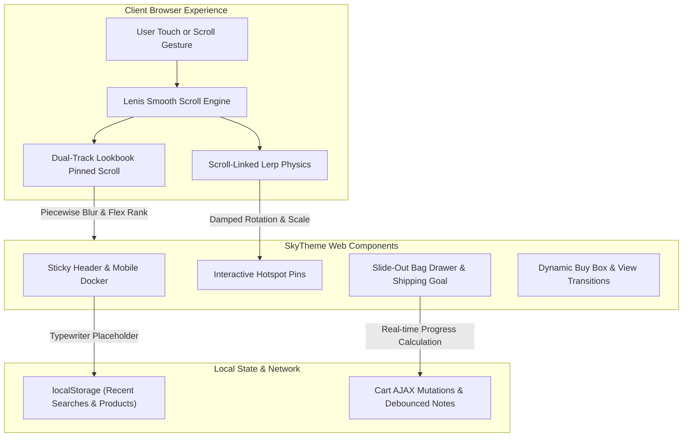

<div align="center">


# 🛍️ SkyTheme Luxury Storefront Engine

### Reference-Guided Storefront Skill, HTML Preview & Shopify OS2 Starter
**Motion Research • Accessible Drawer • HTML Preview • Shopify Liquid Starter**

[](package.json)
[](LICENSE)
[](https://bun.sh)
[](evals/evals.json)
[](https://skills.sh)
[](https://claude.ai)
[](https://cursor.com)
[](https://github.com/imMamdouhaboammar/agent-kernel)

<p align="center">
  <a href="#-overview">Overview</a> •
  <a href="#-invariants">Invariants</a> •
  <a href="#-features-matrix">Features Matrix</a> •
  <a href="#-architecture">Architecture</a> •
  <a href="#-quickstart">Quickstart</a> •
  <a href="#-multi-agent-distribution">Distribution</a> •
  <a href="#-evaluations">Evaluations</a> •
  <a href="#-cli-reference">CLI Reference</a>
</p>

</div>

---

## 📖 Overview

**SkyTheme Storefront** is a reference-guided luxury fashion storefront skill. Historical research notes have unverified reuse provenance and must not be transferred into strict clean-room implementations; independently measured behavioral specifications govern new implementations. It bridges editorial design, fluid momentum physics, and conversion optimization with a documented starting point for independent storefront implementations.

The CLI generates a **standalone HTML demonstration** or a **minimal Shopify Online Store 2.0 Liquid starter**. The detailed reference files describe additional features but do not deploy those features automatically. React/Next.js output is not implemented. A reference comparison and storefront QA are required before claiming any parity.

---


## Clean-room, agent-driven Shopify rebuild (including WebGL)

The repository now includes an opt-in **support-tooling and evidence workflow** for an AI coding agent to reconstruct observable interaction behavior without importing the reference's JS, CSS, Liquid, shaders, fonts or media. **It does not auto-generate a faithful Sky clone.** [Read the runbook](references/clean-room-toolchain.md) and [copy the agent execution contract](agents/clean-room-operator.md).

**Toolchain:** REA (evidence-only), Chrome DevTools MCP, Playwright MCP / Test, Shopify CLI + Theme Check; **Spector.js MCP whenever Three.js/WebGL is observed**. Animate independent implementations with GSAP ScrollTrigger, Three.js, CSS and Shopify Liquid where justified by observed behavior. Record and compare scroll-timed video frames, 3D output and actual store commerce flows before declaring parity.

~~~bash
node scripts/support-tools.mjs doctor --json
node scripts/support-tools.mjs plan
node scripts/support-tools.mjs install --apply
node scripts/setup-spector.mjs doctor
node scripts/setup-spector.mjs plan
node scripts/setup-spector.mjs install --apply
node scripts/support-tools.mjs mcp-config --spector-root "$HOME/.cache/skytheme-support-tools/vendors/Spector.js"
node scripts/clean-room.mjs init --url https://skytheme-demo.myshopify.com/ --out ./workbench
node scripts/capture-motion.mjs --out ./workbench --target reference --viewport desktop --record-video
node scripts/clean-room.mjs audit --out ./workbench
bun run test:toolchain
~~~

All installs require review and an explicit '--apply'; external npm and Spector scripts are never executed by CI. The generated MCP config is **printed**, not written into the agent's configuration. Restart the MCP host and verify live tool calls after registration. Reference captures remain local and should not be redistributed.

**Suggested agent:** Claude Code with Claude Opus 5.5 for sustained design + coding sessions, or Codex with its strongest available GPT-6 reasoning model. Choose a harness with Git, shell, browser and MCP access. The model is not a replacement for the evidence and acceptance gates. For strict clean-room tasks, hand the implementer only sanitized observations, not legacy unverified code samples from this repository.

**Release gate:** Shopify development-store functionality, Theme Editor lifecycle, reduced-motion/mobile behavior, visual *and temporal* capture comparisons, WebGL/Spector evidence where relevant, CI checks, rights ledger, and independent reviewer approval must all be verified. 'run.json' deliberately starts with every gate pending.

## 🛡️ Non-Negotiable Invariants

The standalone preview implements a subset of the intended safeguards; complete Shopify/WebGL validation requires independent testing:

1. **Touch-Momentum & Smooth Scroll Gating:** Programmatic scroll hijacking is strictly gated behind desktop viewports (`!window.matchMedia('(pointer: coarse)').matches && window.innerWidth >= 768`). Mobile devices retain native 120Hz ProMotion/Android momentum.
2. **Accessible Drawer & Modal Confinement:** Every slide-out drawer (`<bag-drawer>`, `<predictive-search>`, `<quick-view-drawer>`) implements `role="dialog"`, `aria-modal="true"`, background scroll locking, Tab focus trapping, and `Escape` key dismissal.
3. **RAF Loop Lifecycle & Epsilon Cancellation:** In scroll-linked Lerp damping animations, an epsilon threshold (`|target - current| < 1e-4`) cancels `requestAnimationFrame` upon settling to prevent GPU battery drain.
4. **GitHub Markdown Mermaid Safety:** All Mermaid diagrams wrap all node labels `["..."]` and edge annotations `-->|"...|"|` in double quotes to guarantee 100% rendering compatibility across GitHub.

---

## 🏛️ Architecture



---

## Reference Feature Catalog (examples and specifications, not all executable)

| Domain | Feature | Description | Reference Implementation |
| :--- | :--- | :--- | :--- |
| **Cart & Checkout** | **Slide-out cart** | Accessible drawer with focus trap & scroll locking | [`references/cart-and-checkout-architecture.md`](references/cart-and-checkout-architecture.md) |
| | **Free shipping goal** | Animated gradient progress bar updating in real-time | [`references/cart-and-checkout-architecture.md`](references/cart-and-checkout-architecture.md) |
| | **Cart notes** | Auto-saving debounced customer note field | [`references/cart-and-checkout-architecture.md`](references/cart-and-checkout-architecture.md) |
| | **In-store pickup** | Modal displaying local store availability | [`references/cart-and-checkout-architecture.md`](references/cart-and-checkout-architecture.md) |
| | **Discount engine** | Instant coupon application inside slide-out drawer | [`references/cart-and-checkout-architecture.md`](references/cart-and-checkout-architecture.md) |
| | **Shipping estimator** | AJAX regional shipping rate calculator | [`references/cart-and-checkout-architecture.md`](references/cart-and-checkout-architecture.md) |
| **Merchandising** | **Lookbook 3D** | Dual-track pinned scroll with rank-decay and Gaussian blur | [`references/animation-engine-and-motion.md`](references/animation-engine-and-motion.md) |
| | **Shop The Look** | Interactive hotspot pins bidirectionally synced with Swiper | [`references/merchandising-and-media.md`](references/merchandising-and-media.md) |
| | **PhotoSwipe Zoom** | v5 lightbox with full-resolution pinch & zoom | [`references/merchandising-and-media.md`](references/merchandising-and-media.md) |
| | **Hover video autoplay** | Streaming lazy video with smooth poster cross-fade | [`references/merchandising-and-media.md`](references/merchandising-and-media.md) |
| | **Color swatches** | Circular color fills with active focus rings | [`references/design-system-and-tokens.md`](references/design-system-and-tokens.md) |
| | **Before/After slider** | Touch-friendly split-screen fabric comparison | [`references/merchandising-and-media.md`](references/merchandising-and-media.md) |
| **Discovery** | **Mobile Docker** | Bottom ergonomics dock with safe-area offset | [`references/product-discovery-and-navigation.md`](references/product-discovery-and-navigation.md) |
| | **Sticky Header** | Scroll thresholds, buffer zones, and auto-hide/reveal | [`references/product-discovery-and-navigation.md`](references/product-discovery-and-navigation.md) |
| | **Typewriter search** | Predictive search with typewriter running placeholder | [`references/product-discovery-and-navigation.md`](references/product-discovery-and-navigation.md) |
| | **Mega Menu** | Tabbed category navigation with embedded promos | [`references/product-discovery-and-navigation.md`](references/product-discovery-and-navigation.md) |
| **Conversion** | **Countdown timer** | Evergreen interval (2h, 6h, 24h) and fixed date modes | [`references/marketing-and-conversion.md`](references/marketing-and-conversion.md) |
| | **Stock counter** | Low-stock urgency warning (< 5 units) | [`references/marketing-and-conversion.md`](references/marketing-and-conversion.md) |
| | **Recently viewed** | Zero-backend history tracking via `localStorage` | [`references/marketing-and-conversion.md`](references/marketing-and-conversion.md) |
| | **Quick view** | Full PDP drawer overlay on collection grids | [`references/marketing-and-conversion.md`](references/marketing-and-conversion.md) |
| | **Trust badges** | Sustainable fibers, 30-day returns, secure checkout | [`references/marketing-and-conversion.md`](references/marketing-and-conversion.md) |

---

## Important implementation limits

- **HTML preview**: illustrates selected interactions; not a Shopify storefront.
- **Shopify starter**: produces Liquid layout, JSON templates, native cart/product forms and merchant-editable sections. It does not yet reproduce Sky's full experience.
- **Animation reference examples**: require integration and browser tests. Timings are illustrative until independently captured.
- **Do not copy** copyrighted Sky code or media from a downloaded page merely because a local copy exists.
- **Do not treat CI syntax checks as visual parity evidence.** See `IMPLEMENTATION_STATUS.md` and `PROVENANCE.md`.

## 🚀 Quickstart

### 1. Standalone HTML Preview (CLI)
```bash
# Generate a standalone demonstration, not a live Shopify theme:
bun scripts/generate-storefront.ts --name "Maison Noir" --out ./dist --scheme scheme-2
```

### 2. Generate a real Shopify Liquid starter

```bash
bun scripts/generate-shopify-theme.ts --out ./shopify-theme-dist
# Follow with Shopify CLI theme check and actual store integration tests.
```

### 3. Validate static bundle integrity
```bash
# Run structural, accessibility, and motion checks on any HTML file:
bun scripts/validate-storefront.ts ./dist/index.html
```

### 4. Run generator checks and browser E2E

```bash
bun install
bun run test:browser
```

### 5. Run static generator checks
```bash
# Run deterministic generator structural checks (not an AI benchmark):
bun scripts/run-evals.ts
```

---

## 🌐 Multi-Agent Distribution

SkyTheme Storefront is distributed as a universal agent skill across all major AI harnesses:

```bash
# Safe local install. Do not pipe the installer to bash:
git clone https://github.com/imMamdouhaboammar/skytheme-storefront.git
cd skytheme-storefront
bash install.sh
```

### Manual Channel Integration:

| AI Harness | Integration Path | Status |
| :--- | :--- | :--- |
| **Claude Code** | `~/.claude/skills/skytheme-storefront` | Local installer when configured |
| **Antigravity / Gemini CLI** | `~/.gemini/skills/skytheme-storefront` | Local installer when configured |
| **Cursor** | `.cursor/skills/skytheme-storefront` | Local installer when configured |
| **Codex / OpenCode** | `~/.codex/skills/skytheme-storefront` | Local installer when configured |
| **Agent Kernel** | `~/.agents/skills/skytheme-storefront` | Local installer |
| **Skills.sh** | `npx skills add imMamdouhaboammar/skytheme-storefront` | Supported installation pattern, verify locally |

---

## 🧪 Behavioral Evaluations & Verification

The previous 10/10 label counted unsupported assertions as passed. The revised checks cover actual generator properties, with separate Chromium interaction tests in CI. Neither suite proves Sky parity:

```bash
bun scripts/run-evals.ts
bun run test:browser
```

- **Test Bank**: [`evals/evals.json`](evals/evals.json)
- **Runner**: `bun scripts/run-evals.ts`

---

## 🛠️ CLI Reference

| Command / Flag | Type | Default | Description |
| :--- | :--- | :--- | :--- |
| `generate` | Command | — | Create standalone HTML preview |
| `--name` | Option | `"AURA LUXE"` | Store brand name rendered across header and titles |
| `--out` | Option | `"./storefront-dist"` | Destination directory for scaffolded assets |
| `--scheme` | Option | `"scheme-1"` | Color scheme ID (`scheme-1` through `scheme-5`) |
| `validate` | Command | — | Validate HTML against design, motion, and accessibility invariants |
| `eval` | Command | — | Execute the 10-benchmark behavioral evaluation suite |

---

## 📄 License

MIT © [Mamdouh Aboammar](https://github.com/imMamdouhaboammar).

**Output safety:** Both generators refuse to overwrite a non-empty directory. Use a fresh `--out` directory for each build. Strict clean-room MCP configuration disables JavaScript evaluation, source maps and file navigation for Chrome DevTools; Spector's source/shader extraction tools are forbidden on the reference.
