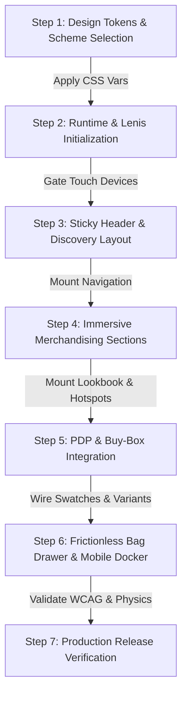

# SkyTheme: Luxury Fashion E-Commerce Storefront Engine

 **Reference-guided architecture:** Research notes and illustrative components informed by an observed storefront. Attribution and rights must be reviewed before reuse.  
> Delivers an ultra-luxury shopping experience combining fine editorial typography, Lenis momentum physics, tactile Web Components, accessible overlay confinement, and frictionless checkout touchpoints.

$$\text{Storefront Spec} \xrightarrow{\text{SkyTheme Engine}} \begin{pmatrix} \text{Tokens \& Color Schemes (1-5)} \\ \text{Lenis Motion \& Epsilon Damping} \\ \text{Custom Web Components} \\ \text{Accessible Bag Drawer \& Hotspots} \end{pmatrix} \xrightarrow{\text{Output}} \text{Production Storefront}$$

---

## ⚡ Universal Skill Contract

| Contract Dimension | Specification |
|:---|:---|
| **Primary Job** | Develop independently implemented luxury storefronts using inspectable reference evidence and tests. The bundled preview is not a production Shopify theme. |
| **Positive Triggers** | "Generate a luxury fashion storefront", "Create SkyTheme e-commerce site", "Add dual-track lookbook with 3D travel", "Build slide-out cart with free shipping bar", "Add mobile docker bottom nav". |
| **Implicit Triggers** | "Need a high-end apparel shop with momentum scrolling and tactile pill controls", "Recreate the skytheme-demo Shopify experience". |
| **Negative Triggers** | Backend database migrations, generic non-luxury CSS resets, unstyled CRUD tables. |
| **Neighbor Collisions** | `minimalist-ui` (general minimalist styling without commerce engine), `landing-page-design` (single-page marketing without cart/merchandising). |
| **Completion Criteria** | A real browser evaluation of interaction behavior, a valid Shopify theme check for the Liquid target, and a documented reference comparison. A passing static evaluation alone is never completion. |

---

## 1. Clean-room implementation invariants

1. **Reference-specific visual and motion values come only from fresh observation.** Existing formulas, CSS values, component names and runtime equations elsewhere in this repository are *legacy research*, not an approved source for a strict clean-room implementation. They are not instructions to reproduce original code.
2. **No forced smooth scrolling on touch.** Follow pointer and motion preferences and only use Lenis when actual reference behavior and platform needs justify it.
3. **Accessible overlays** require keyboard focus confinement, Escape dismissal, focus restoration and background scroll management, verified in real browser tests.
4. **Animation lifecycle** must end RAF loops, listeners, GSAP/ScrollTrigger timelines and WebGL resources on unmount, especially during Shopify Theme Editor section reloads.
5. **Motion is tested as a time-dependent behavior.** Use matched scroll states and synchronized interaction/frame captures; static screenshots alone do not prove animation fidelity.
6. **Only original or appropriately licensed media and code** may enter the deliverable. Isolate source-sensitive observer tooling from the implementer.

## 2. Agent decisions and precedence

For a strict clean-room reference task, the mandatory runbook and [autonomous operator contract](agents/clean-room-operator.md) override historical examples. Source-derived materials in 'references/' are excluded from the implementer context until provenance is independently verified. Implementer freedom is limited by **measured behavior**, not by hard-coded values in this skill. The built-in preview and Shopify starter remain useful for **independent infrastructure tests**, but they do not certify reference parity.

## 3. Feature Reference Catalog (not all features are implemented)

| Category | Features Included | Source Reference |
| :--- | :--- | :--- |
| **Cart & Checkout** | Cart notes, Gift wrapping, In-store pickups, Pre-order, Quick buy, Sign in with Shop, Slide-out cart, Sticky cart, Customer accounts, Free shipping goal bar, Discount engine, Shipping rates estimator | [`references/cart-and-checkout-architecture.md`](references/cart-and-checkout-architecture.md) |
| **Marketing & Conversion** | Trust badges, Stock counter, Recommended products, Recently viewed (localStorage), Quick view drawer, Promo tiles & banners, Product badges, FAQ page, EU translations (EN/FR/IT/DE/ES), Contact form, Countdown timer (Fixed & Evergreen), Back-in-stock alert, Age verifier, Volume pricing | [`references/marketing-and-conversion.md`](references/marketing-and-conversion.md) |
| **Merchandising** | Usage info, Slideshow, Size chart modal, Shipping info, Product videos with hover autoplay, Product tabs, Product options, Lookbooks (Dual-track 3D), Ingredients/nutritional info, PhotoSwipe v5 image zoom, Image rollover (`media-on-hover`), Hotspots, Vertical thumbnail scroll-sync, Color swatches, Before/after slider | [`references/merchandising-and-media.md`](references/merchandising-and-media.md) |
| **Product Discovery** | Back-to-top button, Breadcrumbs, Collection navigation, Predictive typewriter search, Infinite scroll, Tabbed Mega menu, Faceted filtering & sorting, Sticky header with scroll buffer, Swatch filters, Mobile docker bottom nav | [`references/product-discovery-and-navigation.md`](references/product-discovery-and-navigation.md) |
| **Motion & Physics** | Lenis smooth scroll engine, Lerp scroll math, Dual-track Lookbook rank travel, Scatter deck fanned card marquee, Shop-the-Look pin sync | [`references/animation-engine-and-motion.md`](references/animation-engine-and-motion.md) |
| **Design Tokens** | 5 Color schemes (Light Chalk, Night Luxe, White/Orange, Sand, Monochrome), Typography scales, Breakpoints | [`references/design-system-and-tokens.md`](references/design-system-and-tokens.md) |
| **Page Blueprints** | Master templates for Homepage, PDP, Collection, Lookbook, Size Guide, Cart, and Search | [`references/full-page-templates.md`](references/full-page-templates.md) |

---


## Clean-room agentic reconstruction (required for reference parity tasks)

For a request to rebuild a complex Shopify reference **end to end**, **read and follow [references/clean-room-toolchain.md](references/clean-room-toolchain.md) first**. The feature references and preview/scaffold are NOT a verified full theme. The agent must perform live browser observation, record behavioral motion specs, implement original code in OS2 Liquid, and verify paired interaction-video evidence. Never directly copy proprietary code, shaders, captured fonts, or commercial assets.

Required support tools:
- **REA** for behavioral evidence only; **Chrome DevTools MCP** for visual/layout/performance runtime measurements; **Playwright MCP + Playwright Test** for repeatable browser scenarios; **Shopify CLI + Theme Check** for development-store delivery.
- **Spector.js MCP** is mandatory **when WebGL / Three.js is observed**. Capture GL frame/renderer information and aggregate draw statistics only. Discard original shader source, GL resource bytes and textures. Record evidence or an explicit reason why Spector is inapplicable.
- **GSAP / ScrollTrigger / Three.js** are implementation dependencies selected by observed requirements, NOT assumed to be present in the source. For mobile/reduced motion/editor reload, enforce mount/destroy hygiene and resource disposal.

Tool setup is scoped, opt-in and diagnosable; this skill never silently alters the agent's MCP config:
~~~bash
node scripts/support-tools.mjs doctor --json
node scripts/support-tools.mjs plan
node scripts/support-tools.mjs install --apply
node scripts/setup-spector.mjs plan
node scripts/setup-spector.mjs install --apply
node scripts/support-tools.mjs mcp-config --spector-root "$HOME/.cache/skytheme-support-tools/vendors/Spector.js"
node scripts/clean-room.mjs init --url https://skytheme-demo.myshopify.com/ --out ./workbench
node scripts/capture-motion.mjs --out ./workbench --target reference --viewport desktop
~~~

**The observable behavioral specification is the handoff, not the reference's source files.** Run the full test suite, Theme Check, dev-store tests, reference/implementation motion comparison and strict 'clean-room audit'. Do not claim parity from static evals or screenshots alone. A reviewer must sign off every verified gate. Use the implementation status and provenance records before release.

## 4. Reference and copyright policy

- Treat the public Sky demo as a behavioral and visual **reference**, not a license to copy proprietary source or assets.
- Local HTML/CSS/JavaScript captures are research material. Never redistribute or import captured proprietary code without permissions.
- Inspect with browser tools first, then document viewport, dimensions, interactions, timing, scroll states, and evidence paths.
- Never invent a design direction for a reference-locked implementation, and never claim pixel parity without screenshot comparisons.
- The HTML generator is a standalone preview scaffold, not the Sky original. The Liquid generator is a basic Shopify OS2 starter with native commerce forms, not a complete theme.
- See IMPLEMENTATION_STATUS.md and PROVENANCE.md before planning production work.

## 5. Storefront Generation Workflow

When generating a luxury storefront, follow this sequential execution pipeline:



---

## 6. Scaffolding & Validation Tooling

### Scaffolding a New Storefront
```bash
# Generate HTML preview into a new empty ./dist directory:
bun scripts/generate-storefront.ts --name "Maison Minimal" --out ./dist --scheme scheme-1
```

### Generating a Shopify OS2 Liquid Starter
```bash
bun scripts/generate-shopify-theme.ts --out ./shopify-theme-dist
# Next: Shopify CLI theme check and dev-store checkout verification
```
This is a minimal Shopify project scaffold, not a full feature-parity theme.

### Validating Static Bundle Integrity
```bash
# Run structural, accessibility, and motion checks on any HTML file:
bun scripts/validate-storefront.ts ./dist/index.html
```

### Running Deterministic Generator Evals and Real Browser Tests
```bash
# Execute deterministic structural checks only:
bun scripts/run-evals.ts
bun install
bun run test:browser
```

---

## 7. Evidence and provenance

The reference site is observable through authorized browser interactions. This repository contains historical descriptions and examples whose provenance is not line-by-line verified for reuse. They are quarantined from strict clean-room implementation. Record freshly observed evidence, independently authored code, licensed assets, matching visual and temporal comparisons, live development Shopify tests, and reviewer approval as described in [the runbook](references/clean-room-toolchain.md).

*Copyright (c) 2026 Mamdouh Aboammar. MIT License applies only to material the repository is entitled to license.*

Output directories must be new or empty: neither generator overwrites existing files without intervention. If an output already exists, choose a different `--out` directory.
